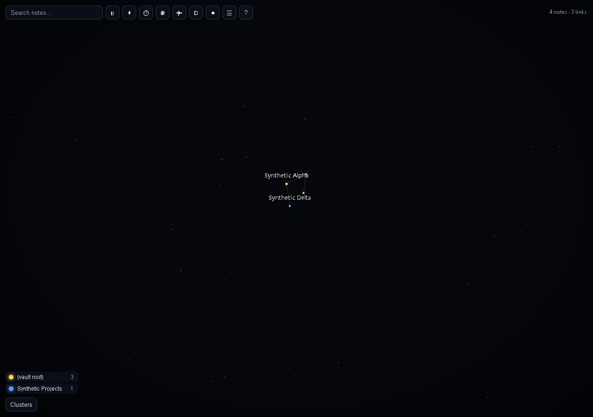
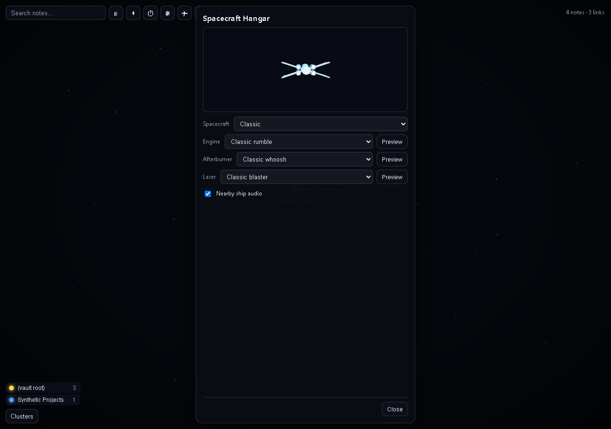

# Obsidian Citizen

Obsidian Citizen turns your notes into a 3D constellation you can explore, fly through, and use as the setting for optional multiplayer space and first-person combat. Maintained by **J117W3**.

## A fork taking a different direction

This project combines Hunter / JusVibin's original [Constellation Graph](https://github.com/xjusvibin/obsidian-constellation-graph) foundation with J117W3's multiplayer, cockpit, docking, and planetary arena work. Hunter's graph, flight, spacecraft, and audio work remains credited, and the original MIT copyright notice is retained. Obsidian Citizen is an independently maintained fork: its direction is a playable space and surface sandbox built around a private note constellation. It is a community project and is not affiliated with Obsidian.

## Download and install

Download the current packaged version from [Obsidian Citizen 0.7.2](https://github.com/j117mw3/obsidian-citizen/releases/tag/0.7.2). Every update from **0.5.1 through 0.7.2** has its own entry on the [Releases page](https://github.com/j117mw3/obsidian-citizen/releases), with individual plugin files, an install ZIP, checksums, and version-specific notes. Earlier 0.3.x releases remain available. Choose the same version on every multiplayer computer.

**Install the published builds:** back up your settings, close Obsidian, and extract one ZIP's `main.js`, `manifest.json`, and `styles.css` directly into `<vault>/.obsidian/plugins/constellation-graph/`. These original packages retain their historical ID and have not been renamed or rebuilt. Requires desktop Obsidian 1.7.2 or newer. See the [archive instructions](docs/historical-builds.md) for verification scope and source-history limitations.

**Plugin identity and settings:** starting with 0.7.2, this independent fork uses the unique `citizen` plugin ID so it cannot overwrite Hunter's plugin. It installs into `<vault>/.obsidian/plugins/citizen/`. Testers moving from the archived `constellation-graph` builds can back up and disable the old plugin, then copy only its `data.json` into the new folder while Obsidian is closed to retain preferences. Keep the original folder as a backup. Saved graph tabs may need reopening with **Open Obsidian Citizen**. The installer does not migrate or delete settings automatically.

Community directory submission is being prepared. GitHub availability does not mean the plugin has been approved or listed in the store.

## Current version: 0.7.2

- Fly eight spacecraft with cockpit instruments, boost, blasters, sound choices, and a pane-responsive Hangar.
- Invite up to three friends to optional private rooms with host-authoritative combat, rounds, checkpoints, and host transfer.
- Dock at main nodes and explore spherical arenas with radial gravity, hills, depressions, static ruins, and paired moving walls associated with linked files.
- Fight four host-controlled planet bots in solo or multiplayer. They patrol, attack after spotting players, pursue recent attackers briefly, and drop one collectible **+30 health** item when defeated.
- Recognizable health-cross and shield pickups show their health amount. Player kills alone count toward the **ten-kill** round win; bot kills do not increase score.
- Rounds pause the fight for the supernova and preserve each pilot’s space position or docked planet position and facing into the next round.
- Version 0.7.1 strengthened terrain relief and fixed linked-wall steering; **0.7.2** adds shared planet combat, bot health drops, clearer pickups, ten-kill rounds, and pose-preserving round changes. Every participant needs **0.7.2 / room protocol 14**.

The [changelog](CHANGELOG.md) records the 0.5.x through 0.7.x development milestones. Each released version has its own GitHub entry with update notes and package files. The 0.5.1–0.7.1 tags preserve recovered plugin files because matching historical TypeScript source snapshots were not saved; 0.7.2 is built from the source in its version tag. Automated checks for this release are recorded in [0.7.2 verification](docs/verification-0.7.2.md); native rendering, audio, cross-computer gameplay, and large-arena performance acceptance remain separate. Large terrain layouts can take several seconds to prepare.

In **Pilot mode**, aim your ship at a main sphere, approach within **12 world units of its surface**, use **X** to brake below speed **10**, and **hold J for 1.5 seconds**. The flight HUD shows range, readiness and hold progress. Only main nodes accept docking. Wait three seconds after damage; the host also enforces arena capacity and safe spawn availability. On the surface, hold **F** for two seconds at either pole to return to your ship.

Surface crouch now defaults to **Left Control**, with a one-time migration from the old C default. Crouch is hold-only; custom key bindings are preserved. Existing toggle preferences migrate to hold; an existing custom binding on Left Control takes priority and crouch receives a non-conflicting fallback. Continuous pistol fire adds **7 heat per shot** and vents on the fifteenth shot. During the two-second vent, shooting and firing effects stop while steam rises from the weapon; holding the trigger resumes firing after cooling is confirmed. Hold right mouse for one second and release for a charged bolt: **50 damage, 55 heat**. Releasing early cancels; charging pauses cooling and blocks normal fire, so two quick charged shots force a vent. A rising electronic charge hum, ready chime, animated energy coils and inward-moving sparks show the buildup. The weapon braces with a subtle vibration; a thicker bolt and charge percentage indicate the alternate shot. These effects follow your laser color and sound settings. Charges cancel on focus loss, death, exit, and host migration; a five-second hold expires. Other normal-shot and cooling values are unchanged. Use the cyan **North** and amber **South** compass cards and direction arrows to find either exit. The shared operative/dummy model now has an articulated fitted suit, outlined helmet and visor, utility gear and pistol.

Surface planets have opaque sci-fi paneling, larger technical sector stamps, low-profile instanced mineral scree, subtle circuitry and lit cyan/amber meridians leading toward the pole exits. These markings add no obstacles or collision. Wall diagnostics have been removed.

Planet combat now has four shared bots per occupied arena, controlled by solo simulation or the multiplayer host. They patrol and avoid obstacles, then cautiously fire on visible players. Damage makes a bot aggressive toward its attacker for a short time; breaking line of sight lets it lose interest. Defeating a bot drops one +30 health pickup, without awarding player-kill score. See the release notes for tuning and multiplayer behavior.

Visible opponents and training patrols show a name above a small red health bar. Both disappear immediately when the displayed head is behind a wall or the curved ground. A centered white hit marker and hit sound indicate confirmed character damage only, including hits absorbed by armor. Shooting walls, the floor or empty space does not trigger the hit marker.

While docked, the planet and cover now occlude graph stars, links and world effects. You can still see unobstructed space above the horizon, but nodes and wires under the ground no longer draw over it. Graph-node labels and ship indicators are also hidden when blocked by an arena sphere. Orbit/flight graph styling returns when you leave the surface; the first-person weapon and intentional pole-navigation HUD remain separate overlays.

## Screenshots

These views use a synthetic vault with four fictional notes; no personal vault names or paths are shown.






## Use

- Ribbon icon (orbit) or the command **Open Obsidian Citizen**.
- It updates live as you add, remove, rename and link notes. Your selection and any hidden groups are kept.

### Mouse

| Action | Result |
|---|---|
| Drag | Orbit |
| Scroll | Zoom |
| Click a note | Select it and fly to it |
| Drag a note | It follows your pointer, its linked notes are tugged along, and on release everything springs back into place with a small bounce |
| Double-click, or Ctrl/Cmd+click | Open the note (Ctrl/Cmd+click opens a new tab) |
| Click empty space | Deselect |
| Right-click | Clear selection and target lock, cancel pending double-click/double-shot actions, and close the details panel |

### Toolbar

| Button | What it does |
|---|---|
| Search | Highlights matching notes and lists them |
| Pause / play | Stops or resumes all motion |
| Reset view | Frames the whole graph again |
| **Animate** | A timelapse: every note disappears, then returns in the order it was created, and each link flashes as it forms. Press again to stop |
| **Supernova** | Solo only: everything is crushed into a point, detonates in one soft flash, re-forms from scratch, and a wave of light runs outward along the shortest paths from the most-connected note (or the note you have selected). Disabled while you are in a multiplayer room |
| Note list | A searchable list of notes, an alternative to the canvas |
| Hangar | Choose a spacecraft, engine, afterburner and blaster sound, and nearby-ship audio |
| Help | Keyboard shortcuts |

### Keyboard

The graph area is focusable. Press **?** for this list in the app.

| Key | Action |
|---|---|
| Left / Right | Previous / next note |
| Up / Down | Step through the selected note's connections |
| Enter (Shift+Enter) | Open the selected note (in a new tab) |
| Space | Pause or resume motion |
| A | Animate (timelapse) |
| N | Supernova (solo only) |
| R | Reset the view |
| L | Show or hide the note list |
| / | Focus search |
| Esc | Clear selection, close a panel |

### Pilot mode

Press **P** in the graph (or the plane button on the toolbar) and fly through your constellation. The **Hangar** offers eight fixed-size ships: Classic, Vector, Dart Freighter, Bulwark Cruiser, Crescent, Revenant, Dart Interceptor and Bulwark Gunship. Each keeps the same gameplay scale, collision size and four-gun firing order. Choose among four synthesized engine, afterburner and laser sounds, preview them, and toggle nearby-ship audio. The cockpit has live health, shields, boost, speed, weapon status and score instruments. Solo fire still selects a note and a second shot opens it; in a room, all notes are navigation targets only.

| Key | Action |
|---|---|
| W / S | Thrust / reverse |
| A / D | Strafe |
| Space / C | Up / down |
| Q / E | Roll |
| Shift | Afterburner (uses an energy tank; when it runs dry it stays empty for a few seconds before it refills) |
| X | Brake |
| Mouse | Steer (see **Mouse mode** below) |
| Click or F | Fire a blaster bolt at what is under the crosshair (6.25 shots per second) |
| T | Lock or unlock the target |
| G | Warp to the target (travel to the marked shared star in multiplayer) |
| H | Warp back out to see the whole graph (disabled in multiplayer) |
| V | Switch between chase and cockpit view |
| R | Switch between blaster and cannon |
| B / Shift+B | Toggle the aimed cluster / toggle all clusters (solo only) |
| N | Cycle spectator camera (multiplayer) |
| Tab | Hold to show multiplayer scores |
| K | Show or hide the controls panel |
| Esc | Free the mouse (a second Esc leaves) |
| P | Leave Pilot mode |

The controls are also shown on screen as a small panel of key caps that light up as you press them, and fades after a few seconds. Chase and cockpit views show drifting space dust; the streaks brighten and the field of view eases wider under afterburner.

- **Mouse mode.** *Capture* hides the pointer and aims directly with its movement (0.0022 radians per pixel at sensitivity 1, smoothed at 90/second and capped at 9 radians/second); stopping the mouse stops the turn without accumulated stick input. *Cursor* keeps the pointer visible and steers by how far it is from the centre, with a dead zone and two faint rings to show it; over a panel or button it stops steering, so you can click the legend, toolbar and details panel while flying.
- **Scale.** Cruise speed is set from the size of your vault, so a bigger vault takes longer to cross: about 12 seconds across a 100-note vault at cruise speed, longer for larger ones. The *Flight speed* setting scales it. Warps take time in proportion to the distance.
- **Wireframes and sound.** The plane has a glowing wireframe outline, and target brackets, impact bursts and faint shells around each group are drawn in wireframe too (they can be turned off). Engine, afterburner, blaster and warp sounds are synthesised in the plugin with the Web Audio API; no audio files are loaded. The Pilot HUD has separate saved **Mute engine**, **Mute afterburner** and **Hangar** controls. The two mutes do not affect blasters, and the master sound and volume controls still apply. Sound mutes when the window loses focus.
- **Cockpit instruments.** The cockpit displays live hull, boost, recharge/lock, speed, weapon selection, ammunition or heat, readiness, firing rate, protection or respawn time, and multiplayer score. A screen-reader text equivalent is available while cockpit view is active.
- Pilot mode needs motion, so it stays off when your system asks for reduced motion (the search, note list and details panel still work). It is not available without WebGL.

### Surface combat

In Pilot mode, **hold J for 1.5 seconds** while aiming at an eligible main node and within docking range to enter its spherical arena. Use **X** to brake; the docking HUD shows distance, speed requirements and hold progress. Walk with **WASD**, sprint with **Shift**, jump with **Space**, hold **Left Control** to crouch, and lean with **Q/E**. Hold **F** near either pole beacon to return to your ship; left-click to fire the laser pistol, or hold right-click for one second and release a charged shot. Players have 100 health, armor pickups add up to 50, normal bolts deal 10 damage and charged bolts deal 50, and walls block shots. Solo mode includes four walking training patrols. Each unique incoming or outgoing linked file creates **two walls** with safe offsets around its direction; six linked files produce twelve walls. Reciprocal links count once. Walls glide along the spherical surface toward their linked files as the graph moves, at up to 0.8 surface units per second. They wait for players (including crouched/leaning upper bodies), retain clearance from other walls, and keep poles and fixed pickups accessible. Occupied arenas retain radius, connection membership and pickup positions; later visits preserve pickup availability and respawn timers. Multiplayer uses host-owned collision poses near players and predicts distant cover from anonymous graph positions. Unlinked mains have open-ground pickups and the four training patrols, with no walls. Radius grows as `27 × sqrt(max(1, connections / 16))` surface units, keeping player and wall sizes unchanged.

The pistol fires at five shots per second, cools between shots and vents after sustained fire. Laser colors are saved per player and brightened when needed for visibility. Network shots use bounded, at-most-150 ms target rewind; 100 ms RTT is the fairness target, while 150–200 ms is treated as degraded latency. These thresholds are covered by automated criteria but still need multi-client runtime verification.

### Multiplayer rooms

The panel shows the version of the loaded plugin code, the selected connection mode, and the room-service hostname. Include those lines and the full status message when reporting a connection failure. A WebSocket close code is included when the server closes before room setup finishes.

Player rows say **Waiting for flight state** until their first authoritative update, then show **flying** or **spectator**. A timeout from one STUN or TURN endpoint is informational while other connection paths are still being tried; an actual peer-connection failure is shown separately.

Open the **Multiplayer** panel, enter a display name, and check the shared-data notice. Create a room to get a ten-character code, then share it with up to three other pilots; or enter a code to join. The panel includes **Copy code** and **Leave**, participant health and state, and connection status. The default ntfy relay carries only encrypted room discovery and WebRTC setup. Players do not need accounts or server setup. The Worker provides temporary TURN credentials after direct connection attempts fail.

Joining shares anonymous star positions, connections, group colors and a restricted pilot profile containing only the chosen ship and sound IDs. It never sends note titles, paths, tags, or contents. Remote constellations have circular stars and no labels, note details, search, selection, dragging, or opening actions. In a room, all note selection and opening is disabled, including for your own notes. Click a star in the shared map, or aim at one and press **T**, to mark it for navigation. Enter Pilot mode and press **G** to fast travel there; destinations may be any participant's anonymous stars. Press **T** again while aiming to change the target. Right-click clears it. **H** remains disabled in a room. Maps update as notes and links change. Each map spreads to twice its solo size around its region center, and ships appear twice as large. A subtle red marker points toward each other flying player and shows their name and distance. Sharing supports up to 20,000 stars and 100,000 links per vault; larger maps show an error instead of silently omitting notes.

Maps, inputs, flight state, combat and checkpoints travel over WebRTC data channels. ntfy is used for encrypted room discovery and peer setup only. If direct connectivity fails, the hosted Worker can issue short-lived TURN credentials; its free relay allowance is shared by all players and may be unavailable after provider limits are reached. Direct connectivity can continue when TURN is unavailable. Choose **Custom server** to use another compatible ntfy relay. See [server/README.md](server/README.md) for deployment notes and service limits.

Firing at other pilots is optional. The host resolves shields, hull damage, weapon heat and cannon ammunition. Destruction gives a five-second respawn and three seconds of protection; firing ends protection. A discreet kill feed and the leaderboard show kills and deaths. The first pilot to ten confirmed player eliminations wins, then the room pauses for an eight-second shared supernova, regenerates each owner's constellation, waits for maps to synchronize, and starts the next round after a three-second countdown. Manual supernova is disabled in a room. Boost drains at 28% per second, recharges at 8% after 1.5 seconds without boosting, stays empty for three seconds when depleted, and pauses recharge for two seconds after damage. Solo cannon ammunition recovers one round every 0.6 seconds; rooms limit each life to 36 rounds. Leaving Pilot mode or hiding the game view makes you a spectator; returning takes five seconds and preserves health and boost. Public-relay rooms use protocol 14 and checkpoint format 14, and require matching 0.7.2 builds. All participants must update together. The hosted Worker continues to serve the historical protocol-4 route.

The Worker keeps temporary TURN credentials and refresh-token sessions in memory, and does not log credentials or gameplay payloads. ntfy can observe room-topic traffic and connection metadata but cannot read room messages without the code. The TURN provider can observe peer IP addresses and traffic volume. Outside an active room, the plugin makes no network connections.

### Accessibility

- **Reduced motion.** If your operating system requests reduced motion, flow, orbiting and camera flights are turned off: the layout settles once and stays still, dragged notes return at once instead of bouncing, and Supernova just recomputes the layout instantly without the show. Animate still works because you asked for it, but without the pop-in effects. You can also set motion to *Off* yourself, or pause at any time.
- **No strobing.** The Supernova has a single soft flash that fades over about a second, and it is skipped under reduced motion and in high-contrast mode.
- **Screen readers.** The canvas is hidden from assistive technology and replaced by a status region that announces the selected note, its group and link count. The note list, search, group legend and details panel are ordinary buttons and lists.
- **No colour-only meaning.** Group names are always shown in the legend, tooltip and details panel, and selected or open notes get a ring as well as a colour change.
- **Colour-blind palette** (Okabe-Ito), **high contrast** (also switched on by the system "more contrast" setting), and adjustable label size.
- **Without WebGL** the 3D view is replaced by the list, search and details panel.

## Settings

Open on startup (off by default), motion, camera, glow, palette, labels and grouping can be configured in plugin settings. Pilot mode adds mouse mode, sensitivity, flight speed and agility, view, sound, volume and separate engine and afterburner mutes. The Hangar saves ship and sound choices plus nearby-ship audio. Multiplayer settings include display name and Public or Custom relay. Earlier localhost WebSocket addresses are preserved as inactive legacy values; new installations use the public relay.

## Network services and privacy

Solo graph and gameplay features work offline. Multiplayer is opt-in and uses these services:

- **ntfy.sh** (or your configured compatible relay): encrypted room discovery and WebRTC setup/recovery messages. The provider receives connection metadata and encrypted payloads. See [ntfy privacy](https://ntfy.sh/docs/privacy/).
- **Google and Cloudflare STUN**: discover connectivity candidates. The services and connected peers can learn network addresses as part of ordinary WebRTC.
- **constellation-rooms.mrassetto.workers.dev** on Cloudflare: issues temporary TURN access tokens and configuration. It handles network addresses for rate limiting and short-lived token state; service code is in `server/worker.js`. See [Cloudflare privacy](https://www.cloudflare.com/privacypolicy/).
- **Metered TURN**: fallback relay when direct WebRTC fails. It relays encrypted WebRTC packets and processes connection metadata. The shared free allowance may run out. See [Metered privacy](https://www.metered.ca/privacy-policy/).
- **Connected players**: receive anonymous graph geometry, chosen public pilot names, and game state over WebRTC. Graph shape itself can reveal structural information; only share rooms with people you trust.

No player account or payment is required. The plugin does not implement analytics or read files outside your vault. Hosting providers apply their own policies. Audio and visual assets are bundled or synthesized locally.


When you explicitly join, peers receive anonymous star positions, links, colors, player IDs, display names, flight and combat state. Note names, paths, tags, file contents and Obsidian vault objects are excluded from network types. Remote stars cannot be selected or opened; a local application boundary also blocks note opening while joined. Map IDs are random for the session and the real file mapping stays local. Audio is synthesized in the plugin. The graph reads Obsidian's index and does not write to note files.

## Performance

Rendering uses point sprites and line segments rather than a mesh per note. A tick of the layout engine costs more as the vault grows, so above a few thousand notes it uses cheaper repulsion and runs at a lower rate when frames get slow, and the bloom pass is dropped first on slow machines. When nothing is moving (motion off or paused, and the camera at rest) it draws nothing.

## Known limitations

- Desktop only (it needs WebGL and a pointer), and Obsidian 1.7.2 or newer.
- Pop-out windows are not specifically supported yet.
- Very large vaults (roughly 10,000+ notes) will be slow to lay out; exclude folders to thin the graph.

## Development

```bash
npm install
npm ci --prefix server # signaling service dependency
npm run dev          # esbuild watch, writes main.js
npm run build        # type-check, then minified production main.js
npm test             # synthetic privacy, protocol, combat, and signaling tests
node dev/run-surface-latency.mjs  # deterministic four-session impairment/oracle matrix
node dev/build-network-harness.mjs
node dev/build-realtime-harness.mjs # native WebRTC hit/oracle trials with scripted targets
node dev/build-surface-preview.mjs # rendered component preview with synthetic nodes
node dev/build-lifecycle-harness.mjs # staged four-client lifecycle integration
node dev/serve-network-smoke.mjs  # loopback signaling plus real browser WebRTC
node dev/serve-network-smoke.mjs 8767 200 25 0.01 # actual UDP: 200 ms RTT, +/-25 ms one-way jitter, 1% loss
npm run build:hosted --prefix server  # validate the Cloudflare Worker bundle
npm run harness -- "<path to a vault>"   # builds dev/harness.html, a browser preview using that vault's notes as mock data
npm run install-local -- "<path to a vault>"   # build and copy into <vault>/.obsidian/plugins/citizen
```

The loopback smoke server prints its browser URL. Open it in four tabs, create a room in one, and join from the others. The synthetic main nodes start in docking range, and the surface controls exercise normal production requests. To share one arena, have its owner dock, select another pilot under **Move my main near**, and move the published main. That pilot selects the owner under **Arena owner** and docks; repeat for the other pilots. Existing occupants follow the moving node. **Fire at visible player** aims an ordinary fire request at the nearest unobstructed opponent; it never changes avatar positions, health, or hit results. Crouch, lean, and walking also send normal controls. This fixture does not inject network impairment or establish FPS rendering quality; its TURN credential requests are disabled. Runtime and rendering limits are described in the version-specific release notes.

Source layout: `src/main.ts` (plugin), `view.ts` (Obsidian view), `data.ts` (vault-to-graph conversion), `app.ts` (UI and accessibility), `renderer.ts` and `sim.ts` (constellation rendering and motion), `pilot.ts` and `flight.ts` (shared flight simulation), `hangar.ts`, `ship.ts`, `importedShipModels.ts` and `cockpit.ts` (spacecraft), `sfx.ts` (synthesized audio), `room.ts` and `netcrypto.ts` (encrypted room discovery), `multiplayer.ts` (WebRTC mesh and anonymous map protocol), `combat.ts` (authoritative flight, weapons, rounds and checkpoints), `server/worker.js` (hosted TURN configuration endpoint), and `server/` (deployment files).

For actual UDP impairment, use the second server command and its printed URL in all four tabs. The optional arguments are RTT (0/50/100/150/200 ms), maximum one-way jitter (0–25 ms), and drop probability (0–0.05). The test wrapper substitutes loopback ICE candidates; native WebRTC still handles encrypted packets and retransmissions. Check that each connection reports **proxy route selected** and an appropriate native RTT before interpreting results. The server prints an ephemeral local access token; proxy statistics omit candidate addresses and ICE credentials. The disposition trial requires four docked players and fresh snapshots. It measures response timing, including rejections, without resetting resources or establishing hit fairness. The revised shared-arena diagnostic passes response timing but still has many view-time rejections; see the verification record for the remaining acceptance gaps. All clients must use the same candidate build.

The generated `/surface-latency.html` page uses four logical clients in one browser context over native WebRTC. Start an impaired loopback server as above and substitute that page in its printed URL, preserving the relay and UDP parameters. Use one server/port per concurrent room. The 0–100 ms fairness profiles run 20 cases with at least 500 accepted shots each; allow roughly two hours per profile. At 150–200 ms, the explicit attempt sample mode can instead collect 500 fire attempts for degraded stability/disposition checks, reporting accepted counts and hit metrics without a competitive-parity claim. Attempt mode is rejected through 100 ms. Targets, walls, and health resets are fixture controls. Results measure registration and response timing, not observed player movement, pickup lifecycle, WebGL, or audio. `/surface-preview.html` renders the actual surface components using synthetic nodes and explicitly staged ship/camera poses; it reads no vault and does not certify native Obsidian behavior.

For `/surface-lifecycle.html`, start a dedicated server with `node dev/serve-network-smoke.mjs 8774 200 25 0.01` and substitute the page in its printed URL. It stages ship/body poses and initial combat resources, then sends ordinary docking, input and fire requests. Checks use real pickup, respawn and countdown timers, observe simultaneous collection, pole interruption/return, stale-life fire rejection and five surface eliminations. Synthetic layout republication stands in for the renderer's supernova animation. It does not prove traversal, native Obsidian visuals/audio, or an unstaged gameplay session. A failed or cancelled run is not acceptance; record any browser scheduling emulation separately.

## Licence and third-party notices

Obsidian Citizen is J117W3's fork of [Constellation Graph by JusVibin](https://github.com/xjusvibin/obsidian-constellation-graph). The original copyright and MIT notices are preserved. Screenshots above are synthetic-vault views; they do not depict the new surface arenas.

MIT, see `LICENSE`. The bundled `main.js` includes:

- [Three.js](https://threejs.org), MIT licence, copyright the Three.js authors.
- [fflate](https://github.com/101arrowz/fflate), MIT licence, copyright Arjun Barrett; bounded lossless compression of protocol 14 JSON messages.
- [d3-force-3d](https://github.com/vasturiano/d3-force-3d), MIT licence, copyright Vasco Asturiano; it builds on [d3-force](https://github.com/d3/d3-force) (ISC licence, copyright Mike Bostock) and related d3 modules (ISC, BSD-3-Clause).
- [ws](https://github.com/websockets/ws), MIT licence, used by the separate signaling service.

Full licence text for each travels with its package under `node_modules` and is preserved at the end of `main.js`.
