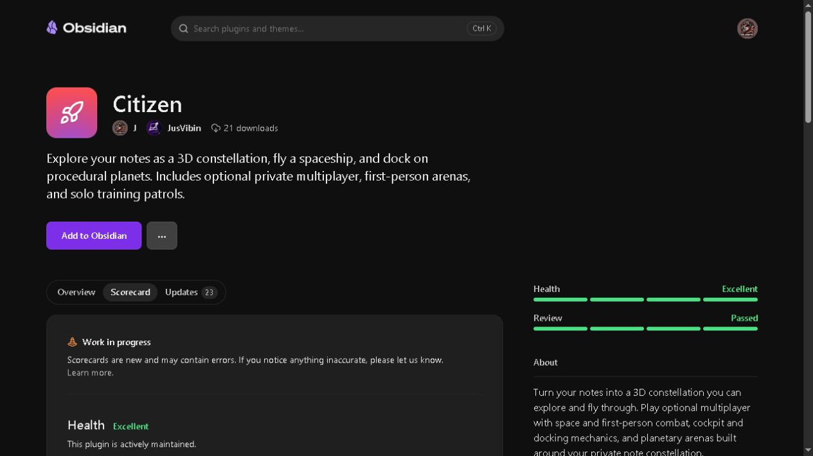

# Citizen 0.7.6 verification

Citizen replaces the rejected OB Citizen display name. The plugin ID remains citizen; settings, room protocol, and checkpoint protocol remain unchanged at 14.

## Local checks

- Production build and TypeScript checking passed.
- ESLint checks all src and dev TypeScript with zero warnings, including typed unsafe-value and deprecated-API rules. CSS checks reject !important and :has.
- All 240 automated tests passed, including two new tests covering valid and malformed WebRTC statistics. Existing settings, anonymous topology, invalid network data, multiplayer, combat, and terrain checks passed.
- Network, real-time surface, surface preview, and lifecycle browser harness builds passed.
- Dependency audit reports zero vulnerabilities.
- Two logical clients on the loopback signaling fixture established native browser WebRTC, joined one room, received anonymous maps/positions, docked independently, accepted an authoritative surface shot, and left cleanly. The preview and both room clients logged zero browser warnings/errors. This does not establish cross-computer connectivity.
- Synthetic browser preview: graph and Hangar rendered; engine-preview control completed; staged surface docking rendered the HUD and hid graph controls. This is browser component evidence, not native Obsidian acceptance or proof of audible output.
- Native Obsidian capture failed twice with capture/channel timeouts. Native popout, live vault reload, cross-computer multiplayer, and audible-output acceptance are not claimed.

## Published release and directory acceptance

- Published [Citizen 0.7.6](https://github.com/j117mw3/obsidian-citizen/releases/tag/0.7.6) as latest on October 16, 2026.
- Immutable tag/source: `5c82955851173e008088bca882db605fab5ab73c`.
- [Release workflow 38963455554](https://github.com/j117mw3/obsidian-citizen/actions/runs/38963455554) passed lint, build, all 240 tests, packaging, and provenance attestation.
- Downloaded all three draft assets and compared their SHA-256 digests and sizes with GitHub metadata. The bundle matched the locally verified production build; manifest and stylesheet matched the tagged Git blobs exactly. Public downloads were verified again after publication.
- Retrieved provenance bundles for all three assets and matched their subject digests. The directory independently verified the main.js and styles.css GitHub artifact attestations.
- Downloaded the workflow artifact, verified its SHA256SUMS.txt, and confirmed the install ZIP contains exactly the same three plugin files as the release. Private-marker scans passed.
- The second branch preview and published release review completed without source or CSS warnings. The published review confirmed no suspicious network patterns, no vulnerable dependencies, and a main.js build reproduced byte-for-byte.
- The [public scorecard](https://community.obsidian.md/plugins/citizen#scorecard) shows **Health: Excellent** and **Review: Passed**. The current accepted version is 0.7.6. The listing automatically adopted Citizen from the release metadata, resolving the preview's old-name mismatch.

| Asset | Bytes | SHA-256 |
| --- | ---: | --- |
| main.js | 1134509 | `22791f72c169d7364d5b23583cbbea48365272af586be03c3a31f2d79db8aa1a` |
| manifest.json | 383 | `94098d0ce086963f081f9a17c71cc128aefd92584b3fe75a928c862d25f86c41` |
| styles.css | 42717 | `fe82be68f8f0f381a2ba797546ce0326d662df6292ea17feaf0b149186fef398` |

Only `main.js`, `manifest.json`, and `styles.css` are attached to the release. ZIP/checksums are workflow artifacts. Historical releases, attribution, and the pre-existing untracked verification-0.7.2.1.md are preserved.

## Remaining disclosures and verification limits

The two behavior recommendations remain intentionally: vault enumeration is necessary for the local graph, and clipboard access is limited to user-triggered room-code writes. There are no clipboard reads. Names, paths, tags, and note contents remain local. The scorecard also discloses runtime base64 operations and unavailable malware/obfuscation scans; it still rates Review Passed.

Native Obsidian capture failed, so native popout rendering, live-vault reload, audible output, and cross-computer gameplay were not revalidated. Passing the directory review and browser fixtures does not establish those runtime outcomes.
